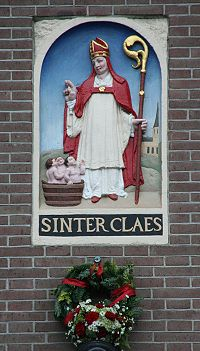

"De beuze slager" is wel de meest geschikte Sinterklaaslegende om echt in de Sint-stemming te komen.

De muziek van het lied gaat aldus:
[sinterklaaslegendelied.gif](/files/sinterklaaslegendelied_0.gif "Download: sinterklaaslegendelied.gif (22.96 KB)")

De tekst:

Drie kind'ren gingen, hand in hand&#x2028;
 Eens aren lezen op het land
 Maar toen de avond was gedaald&#x2028;
 zijn z'in de dui---sternis verdwaald&#x2028;
 Een slager had zijn licht nog aan ---
 &#x2028;Daar zijn ze schuchter heengegaan

Drie kind'ren gingen, hand in hand
 &#x2028;Eens aren lezen op het land

Ze vroegen aan de slager, zacht
 &#x2028;Een toevlucht voor de koude nacht&#x2028;
 Komt binnen, lieve kind'ren, zie
 In 't bed daar is wel plaats voor drie!

&#x2028;&#x2028;Drie kind'ren gingen, hand in hand&#x2028;
 Eens aren lezen op het land

Maar nauwelijks in bed gebracht
 &#x2028;Heeft hij ze één voor één geslacht
 &#x2028;Waarna hij ze in stukjes sneed&#x2028;
 En in een vat met pekel deed

Drie kind'ren gingen, hand in hand
 &#x2028;Eens aren lezen op het land

Sint Nicolaas, na zeven jaar
 &#x2028;Kwam eens voorbij die slager daar&#x2028;
 Hij klopte aande deur, heel zacht&#x2028;
 En vroeg een toevlucht voor de nacht

Drie kind'ren gingen, hand in hand&#x2028;
 Eens aren lezen op het land

Kom binnen, Sint Niklaas en zie:
 &#x2028;In 't bed daar is wel plaats voor drie!&#x2028;
 Na dit zo rond en gul onthaal&#x2028;
 Vroeg Sint Niklaas zijn avondmaal

Drie kind'ren gingen, hand in hand&#x2028;
 Eens aren lezen op het land

Geef het gepekeld vlees me, dat&#x2028;
 Reeds zeven jaar ligt in dat vat!&#x2028;
 Nauw' had de slager dat gehoord&#x2028;
 Of hij verschrok en vluchtte voort

Drie kind'ren gingen, hand in hand
 &#x2028;Eens aren lezen op het land

O, vlucht niet slager, toon berouw&#x2028;
 Vergeving schenkt dan God, vertrouw&#x2028;S
 int Nicolaas liep naar het vat&#x2028;
 Ging zitten op de rand, en bad

Drie kind'ren gingen, hand in hand&#x2028;
 Eens aren lezen op het land

Kom, lieve kinderen, ontwaak!&#x2028;
 Sint Niklaas wekt u uit de vaak!&#x2028;
 Drie vingers hij geheven had&#x2028;
 De kind'ren stegen uit het vat

Drie kind'ren gingen, hand in hand&#x2028;
 Eens aren lezen op het land

De eerste zei: Wat sliep ik zacht&#x2028;
 De tweede: Mooi gedroomd, vannacht&#x2028;
 De derde: Is de nacht al om?
 &#x2028;'t Is of ik uit de hemel kom!

Drie kind'ren gingen, hand in hand&#x2028;
 Eens aren lezen op het land

Franse ballade uit de 17de eeuw, bewerkt door H. de Vos

<object width="320" height="240"><param name="movie" value="http://www.youtube.com/v/QhGWd_ze9dM&rel=1"><param name="wmode" value="transparent"><embed src="http://www.youtube.com/v/QhGWd_ze9dM&rel=1" type="application/x-shockwave-flash" wmode="transparent" width="320" height="240"></object>
