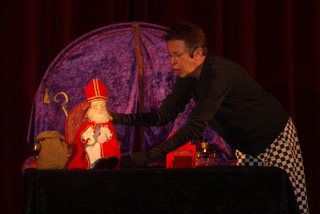
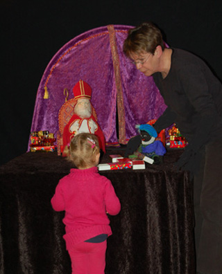

Helaas, deze voorstelling is verkocht en wordt dus niet meer gespeeld!

Het kleine Pietje is voor de eerste keer met de Sint mee naar Nederland en hij moet dus nog een heleboel leren. 
Hij doet erg zijn best, maar er gaat toch een hoop fout. Het ergste is, dat hij de pakjes weer uitpakt, omdat hij ook zo graag eens een cadeautje wil krijgen. Maar Sinterklaas begrijpt gelukkig een heleboel en het loopt dus goed af. 
Er is ook een (kleine) rol weggelegd voor een witte Bakpiet, maar Pietje zelf is traditioneel zwart.

Intieme Sinterklaasvoorstelling voor kleine kinderen met veel eenvoudige liedjes, begeleid op de trekharmonica. 
Klik [hier](</files/Liedjes Wiedewiet(nieuw).doc>) voor een liedjesblad, met aan de huidige tijd aangepaste teksten. 
En hier hoort u de muziek van: 
[Kleine Piet, wiedewiedewiet](/files/Wiedewiet.mp3) (helaas nog met de oude tekst) 
[Hop hop hop](/files/hop_hop_hop.mp3)

Veel interactie met het publiek. 
Peterselie speelt het liefst op locaties waar de echte Sint niet ook komt, omdat de voorstelling het leukst is als het publiek goed geconcentreerd kan kijken (en dat lukt vanzelfsprekend minder goed als Sint nog moet komen!).

leeftijd: niet jonger dan 2 jaar, niet ouder dan 6 jaar 
geschikt voor mensen met een verstandelijke beperking 
duur: 35 tot 45 minuten 
opbouwen:1,5 tot 2 uur 
speelvlak: 3 x 3 meter 
prijs: op aanvraag 
reiskosten: €0.30/km 
ideale aantal kinderen: 45 
verduisterde zaal met gedempt zaallicht

 
Marjanne van Poppentheater Peterselie helpt de vermoeide Sint op een stoel

 
Sint, Kleine Pietje en het Schimmeltje

 
Kleine Pietje krijgt hulp bij het inpakken

 
Soms is Sint heel moe van zijn eigen verjaardagsfeestje....

Zie voor een middeleeuwse Sinterklaaslegende (die op het lijstje van Peterselie staat om nog 'ns te bewerken): [Sinterklaaslegende](/sinterklaaslegende)
