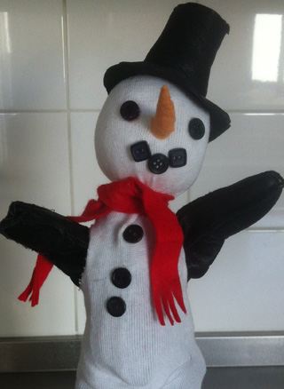
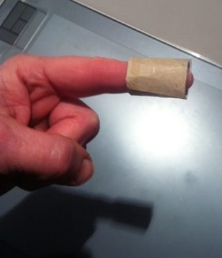
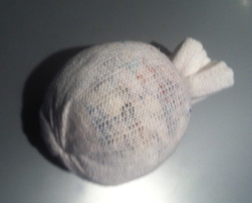

 Maak een kokertje om je vinger met een oude wc-rol en plakband.

 Vul de teen of (zoals ik heb gedaan) het boord van een oude sok (boord eerst aan 1 kant strak afbinden, dan binnenste buiten keren en vullen).

 Duw met de vinger het kokertje in de gevulde bol, doe rondom aan de buitenkant van het kokertje, wat lijm en bindt, ter hoogte van het kokertje, de bol af met katoen. Natuurlijk kun je ook meteen beginnen met een hele sok en die vullen, maar als je een binnen-"kop" gebruikt, is de kleur van het vulsel niet zo belangrijk en kun je allerlei knipsevullingl gebruiken (zeer meditatief: bij tv of zo allerlei oude t-shirts tot knipsel omwerken....).

 Knip aan de zijkant 2 gaten voor de vingers. Om het een beetje duurzaam te maken, kun je lijm langs de randen strijken, of er zelfs een zoompje in leggen!

 Lijm er zwarte knoopjes op als ogen, mond en knopen.

 Van oranje vilt (of schoonmaakdoekjes) knippen we een driehoek. Dichtnaaien en op kop lijmen of naaien. Van zwart vilt (of dun leer) een hoed. Lijm op hoofd van de sneeuwpop.
 Rood vilt voor het dasje. Een bezem is eenvoudig te maken van een stokje met wat takjes.
 Als je een zwarte of witte handschoen (voor de armpjes) gebruikt, zie je je vingers niet, maar het hoeft natuurlijk niet.
