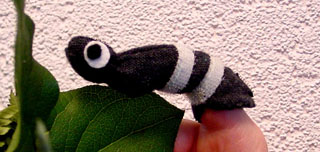
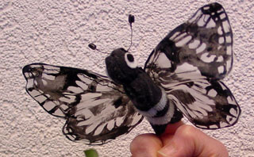

Kijk voor referenties, krantenknipsels e.d. ook bij [wat men schrijft](/watmenschrijft) over de optredens van Poppentheater Peterselie.

 Moentje uit "Gaatjes in je tong" van (toen nog) Poppentheater de Verhalendoos

**2025**
 12 jan 25, Kielzog, Hoogezand, OPTIE

20 jun 25, BoekStartuurtje Bibliotheek Hoogezand, peutervoorstelling

**2024**

24 jan 24, middag, Bibliotheek Winschoten, *Prent en Pop, inspiratiesessie Voorleesdagen*

21 feb 24, De Schierstins, Veenwouden, *Doornroosje*, 4 tot 10 jaar, OPENBAAR

19/20 mei 24,6x, Sprookjestuinen, Diever, *Vertelvoorstelling De Rattenvangster*

14 sep, middag, Kerk Appelscha, *Een dame en 10 poezen*

21 sep, 10.30u, De Plataan, Meppel, *Muis zoekt huis*, 2 tot 6 jaar, OPENBAAR

11, 12, 13 nov 24, Drenthe College, Emmen, Cultuurweek

**2023**

16 feb 23, 2x ochtend, Genemuiden, *Muis zoekt huis*

1 mrt 23, ochtend, De Spil, Nieuwleusen, *Nog een keertje! 2+*

3 mrt 23, middag, De Spil, Nieuwleusen, *Doornroosje 4+*

5 mrt 23, 10.30u, Dorpshuis Dwingelo, *Doornroosje 4+*

12  apr 23, 10.15u, Kindcentrum Oudleusen, *Alle eendjes..."*

3 mei 23, 10.30u, Lawei Drachten, *meedoe-voorstelling Een dame en 10 poezen*, OPENBAAR, 5 t/m 8 jaar

17 mei 23, ochtend, BS Talentum, Zwolle, *De Rattenvangster*

20 jul 23, ochtend, SBO De Brug, Zwolle, *De Prinses op de Erwt*

19 aug 23, Pesserfeest, Pesse, *Muis zoekt huis*

10 sep 23, Meppel Tuintheater, 3x, *Nog een keertje!*

27 sep 23, poppenspeltraining Aveleijn, Borne

5 okt 23, Basisschool De Zevensprong, Zwolle, *Muis*

10 okt 23, 2x, Prinses Beatrixschool, Urk, *Muis*

11 okt 23, ochtend, Montessori Basisschool Zwolle, *Muis*

20 dec 23, ochtend, Kindcentrum de Fontein, Barneveld, *Van de Ster en de Stal*

**2022**

19 feb 22, 10.30u, De Plataan, Meppel, *Muis zoekt huis*, 2 tot 6 jaar, OPENBAAR

16 mrt 22, 10u, Prins Willem Alexanderschool, Elburg, *Muis zoekt huis*

13 mei 22, reünie 2a, Oosterhout, *Doornroosje voor volwassenen*, besloten

18 mei 22, 2x, kinderopvang Oudleusen, *Nog een keertje!*

1 jun 22, 11u, School Lyndensteijn, Beetsterzwaag, *Alle eendjes...*

11 juni22, 14u, Opmaat, Bedum, *Alle eendjes (verkorte versie)*

15 jun 22, 10u, Peutercafé Hoogezand, *Muis*, 2,5 tot 6 jaar, OPENBAAR

16 jun 22, 10.30, Feesttent Koekange, *Muis*

13 jul 22, Basisschool De Korenaar, Franeker, *Muis*

22 aug 22, MFA De Schakel, Stadskanaal, *Muis*

17 sep 22, 10.30u, De Plataan, Meppel, *peutervoorstelling Nog een keertje!*, OPENBAAR, vanaf 2 jaar

24 sep 22, Sprookjestuinen, *Doornroosje voor volwassenen*, OPENBAAR

15 okt 22, ochtend, Brasserie Oer, Havelte,*Nog een keertje!*, OPENBAAR, 2 tot 6 jaar

16 okt 22, 14u, Borg Verhildersum, *Meedoe-voorstelling De Prinses op de Erwt*, OPENBAAR

30 okt 22, Kloosterburen, *Doornroosje voor kinderen*, OPENBAAR, 4 tot 9 jaar

17 dec 22, De Plataan, Meppel, *Kerstverhaal*, familievoorstelling, OPENBAAR

21 dec 22, School Lyndensteijn, Beetsterzwaag, *Kerstverhaal*

22 dec 22, Meppel, *Doornroosje (voor volwassenen)*, BESLOTEN, OPTIE

**2021**

21 aug 21, 15u, Hunebedcity, Borger, "Doornroosje", vanaf 4 jaar, OPENBAAR

28 + 29 aug 21, 13.00u + 14.30 uur + 16.00 u, Sprookjestuinen, Brasserie Oer, Havelte, "Doornroosje", vanaf 4 jaar, OPENBAAR

18 sep 21, 10.30u, De Plataan, Meppel, *"Alle eendjes..."*, 2-6 jaar, OPENBAAR

2 okt 21, 10-12u, Kom Kinderopvang Open dag, Wapenveld, *Nog een keertje!*, 2+ (gecanceld wegens corona)

21 okt 21, 14u, De Schierstins, Veenwouden, *Alle eendjes....*, 2 tot 6 jaar, OPENBAAR

30 oktober, 15u, Nicolaaskerk, Kloosterburen, *Muis zoekt huis*, OPENBAAR, 3 - 7 jaar

17 nov 21, 11u, School Lyndensteijn, Beetsterzwaag, *Muis zoekt huis*, (gecanceld wegens corona)

8, 14, 15, 17, 21, 24 dec 21, Huize Odoorn,
 Kerstproject

11 dec 21, Dorpshuis Westdorp, meedoe-voorstelling Kerstverhaal, besloten, (gecanceld wegens corona)

18 dec 21, pg-Roermond, *Van de Ster en de Stal*, (gecanceld wegens corona)

22 dec 21, 11u, School Lyndensteijn, Beetsterzwaag, *Van de Ster en de Stal*, (gecanceld wegens corona)

23 dec 21, Kindcentrum De Fontein, Barneveld, *Van de Ster en de Stal*, (gecanceld wegens corona)

**2020**

20 feb 20, 14u, De Schierstins, *Nog een keertje!*, OPENBAAR (2-6 jr)

21 mrt 20, 10u, Bibliotheek Dokkum, *Alle eendjes...*, OPENBAAR (2 tot 4 jaar), (gecanceld wegens corona)

25 mrt 20, 9.30u, CBS Prins Willem Alexander, Elburg, *Muis*, (gecanceld wegens corona)

27 mrt 20, 15u, Make a wish, Kasteel Hierden, *meedoevoorstelling Prinses op de erwt*, (gecanceld wegens corona)

1 apr 20, ochtend, Kdv Oudleusen, *Muis zoekt huis*, (gecanceld wegens corona)

1 apr 20, middag, Kdv Luttenberg, *Muis*, (gecanceld wegens corona)

4 apr 20, psz Porkenhoes, Borger, *Muis zoekt huis*, (gecanceld wegens corona)

27 apr 20, Koningsdag Bathmen, *Vertelversie Rattenvangster*, OPENBAAR, OPTIE, (gecanceld wegens corona)

15 mei 20, Baby/Peutercafe Hoogezand, *Nog een keertje!*, OPENBAAR, (gecanceld wegens corona)

mei, psz Kidz First, Bovensmilde, *Nog een keertje!*, (gecanceld wegens corona)

30 jun 20, 2x, Skid Kinderopvang Eelderwolde, *Nog een keertje!*

15 jul 20, 19u, camping de Berken, Gasselte, *meedoe-voorstelling*, (gecanceld wegens corona)

15 aug 20, 13-16u, Poppenspeldag Poppelepee, Poolshoogte Odoorn, GRATIS, OPENBAAR

14 okt 20, Open Persdag Fruithof Frederiksoord, *Muis zoekt huis*, OPENBAAR (3-6 jaar), (gecanceld wegens corona)

17 okt 20, 15u, Hunebedcity, Borger, *Muis zoekt huis*, OPENBAAR, (gecanceld wegens corona)

12 dec 20, 15u, Hunebedcity, Borger, *Van de Ster en de Stal*, familievoorstelling, OPENBAAR, (gecanceld wegens corona)

17 dec 20, 15u, OBS De Dreske, Roswinkel, *Ster en Stal*, (gecanceld wegens corona)

19 dec 20, 14.30u, Minderbroederkerk, Roermond, *Ster en Stal*, (gecanceld wegens corona)

**2019**

2 feb 19, 10.30u, RKBS St. Vitus, Winschoten, *Nog een keertje!*

16 mrt 19, 10u, pst Porkenhoes, Borger, *Alle eendjes...*

19 mrt 19, 2x, BS De Aquarel, Zwolle, *Pien en de Wolf*

5 apr 19, 9-12u, Hunzehuys, Borger, *Wenspop maken*, OPENBAAR (opgeven via info@peterselie.nl)

12 apr 19, 9-12u, Hunzehuys, Borger,  *Wenspop maken*, OPENBAAR (opgeven via info@peterselie.nl)

15 apr 19, 20u, Vrouwen van nu, Eeserhof, Ees, *workshop*

26 apr 19, 9-12u, Hunzehuys, Borger,  *Wenspop maken*, OPENBAAR (opgeven via info@peterselie.nl)

27 apr 19, Koningsdag Bathmen, *kleutervoorstelling*

17 mei 19, Baby/Peutercafe Hoogezand, *peutervoorstelling*, OPENBAAR

14 sep 19, 11u, Kopje Cultuur, Bibliotheek Steenwijk, *Alle eendjes...*, OPENBAAR, peuters/kleuters

27 sep 19, 2x middag, Kdv Boomhut, Groningen, *Alle eendjes...(verkort)*

13 nov 19, 11u, Marjolijn Adema, *Muis zoekt huis*

2 dec 19, 10u, Holle Bolle Boom, Marum, *Nog een keertje! (Sinterklaas-versie)*

18 dec 19, BS De Fontein, Barneveld, *Van de Ster en de Stal*

**2018**

27 jan 18, 2x middag, Zinin, Nijverdal, *Nog een keertje!*, OPENBAAR, 2-6 jaar.

7 mrt 18, 15-17u, Cultuurmarkt Emmen

14 mrt 18, 13.30u, Brede School Nieuw-Amsterdam, *meedoe-voorstelling "Van 10 domme heksjes"*

21 mrt 18, 3x ochtend, Quintus, Kampen, *Rattenvangster Verteltheater*

2 apr 18, 2x middag, Sail Kampen, *Visser en zijn Vrouw"*

14 apr 18, 10u, psz Porkenhoes, Borger, *Nog een keertje!"*

20 apr 18, 17u, Festival Gekleurd Grijs, Emmen, *Een dame en 10 poezen*, gratis, OPENBAAR

17+18 mei 18, 10 u, OB Hoogezand + OB Slochteren, Baby+PeuterCafe, *Nog een keertje!*

6 jul 18, ochtend, Vrije School Wageningen, *Muis zoekt huis*

11 jul 18, 14u, psz Dalfsen, *Alle eendjes...*

12 jul 18, 11.15u, CBS De Lindenborg, Musselkanaal, *Muis*

13 jul 18, 11u, W. v. Oranjeschool, Kampen, *Muis*

18 jul 18, ochtend, pst Hummelhof, Zuidbroek, *Alle eendjes...*

22 jul 18, 14u, Duurzaamheidscentrum, Assen, *Alle eendjes..."*, 2 tot 6 jaar, OPENBAAR, opgeven via info@peterselie.nl

9 aug 18, 14u, Duurzaamheidscentrum, Assen, *Nog een keertje!"*, 2 tot 6 jaar, OPENBAAR, opgeven via info@peterselie.nl

23 aug 18, 11 + 14u, Triasgebouw Meppel, *Nog een keertje!*, OPENBAAR, peuters en kleuters

25 aug 18,  14u, Duurzaamheidscentrum, Assen, *Muis zoekt huis*", 2 tot 6 jaar, OPENBAAR, opgeven via info@peterselie.nl

8 sep 18, 14 + 15u, kinderdagverblijf Mickey, Hengelo, *Alle eendjes...*

17 sep 18, 10 jarig bestaan Ipse De Bruggen, Nootdorp, *Alle eendjes...*

2 okt 18, middag, Hoornbeeckcollege, Kampen, *Coaching Handpoppenspel*

9 okt 18, 2x, Chr. Dalton Basisschool Kon. Emma, Zwolle, *meedoe Poezen*

24 okt 18, 13 + 15u, Culturele Raad Eelde, *Muis zoekt huis*

26 okt 18, 11 + 13u, KansPlusSien  NOP, Emmeloord *Muis zoekt huis*

7 nov 18, Peuterspeelzaal Oudleusen, *Alle eendjes...*

27 nov 18, 13 - 15.15u, St. Voor Altijd Jong, Borger, *workshop Kerst*

30 nov 18, 9.45u, Kinderopvang Marum, *Nog een keertje!*

18 dec 18, 13u, St. Voor Altijd Jong, *workshop schimmenspel*

20 dec 18, middag opbouwen, 19u voorstelling, Voor Altijd Jong, Borger, *meedoe-voorstelling Van de Ster en de Stal*

22 dec 18, 14 + 15u, Verpleeghuis Carinova, Deventer, *Kerst klein*

25 dec 18, 11u, Prot. Gem. Grolloo, *Van de Ster en de Stal*, OPENBAAR, familievoorstelling

 Klapbek-klomphond van Poppentheater Peterselie

[speellijst2017.docx](https://peterselie.nl/files/speellijst2017.docx "Download: speellijst2017.docx (92.3 KB)")
[speellijst2016.docx](https://peterselie.nl/files/speellijst2016.docx "Download: speellijst2016.docx (102.65 KB)")
[speellijst2015.docx](https://peterselie.nl/files/speellijst2015.docx "Download: speellijst2015.docx (83.87 KB)")
[speellijst2014.doc](https://peterselie.nl/files/speellijst2014.doc "Download: speellijst2014.doc (47.5 KB)")
[speellijst2013.doc](https://peterselie.nl/files/speellijst2013.doc "Download: speellijst2013.doc (30.5 KB)")
[speellijst2012.doc](https://peterselie.nl/files/speellijst2012.doc "Download: speellijst2012.doc (50 KB)")
[speellijst2011.doc](https://peterselie.nl/files/speellijst2011.doc "Download: speellijst2011.doc (28 KB)")
[speellijst2010.doc](https://peterselie.nl/files/speellijst2010.doc "Download: speellijst2010.doc (54 KB)")
[speellijst2009.doc](https://peterselie.nl/files/speellijst2009.doc "Download: speellijst2009.doc (63.5 KB)")
[speellijst2008.doc](https://peterselie.nl/files/speellijst2008.doc "Download: speellijst2008.doc (61.5 KB)")
[speellijst2007.doc](https://peterselie.nl/files/speellijst2007.doc "Download: speellijst2007.doc (68.5 KB)")
[speellijst2006.doc](https://peterselie.nl/files/speellijst2006.doc "Download: speellijst2006.doc (80.5 KB)")
[speellijst2005.doc](https://peterselie.nl/files/speellijst2005.doc "Download: speellijst2005.doc (37 KB)")
[speellijst2004.doc](https://peterselie.nl/files/speellijst2004.doc "Download: speellijst2004.doc (59.5 KB)")
[speellijst2003.doc](https://peterselie.nl/files/speellijst2003.doc "Download: speellijst2003.doc (36 KB)")
[speellijst2002.doc](https://peterselie.nl/files/speellijst2002.doc "Download: speellijst2002.doc (36 KB)")
[speellijst1996tot2001.doc](https://peterselie.nl/files/speellijst1996tot2001.doc "Download: speellijst1996tot2001.doc (61.5 KB)")

