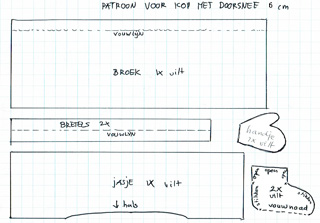
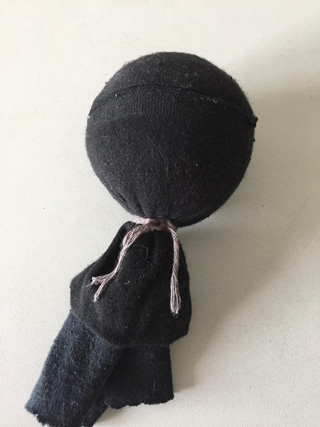
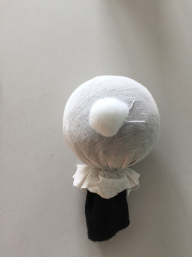
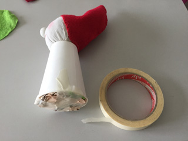
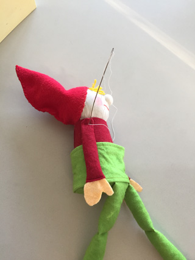
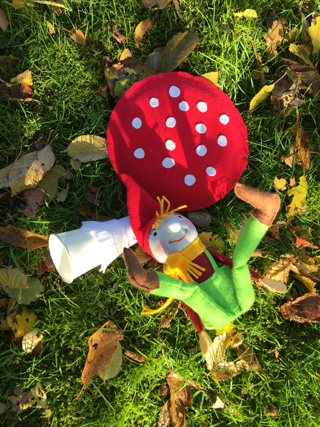

Klik op het patroon voor een A4-patroon op ware grootte.

 Vul een stuk tricot of de teen van een sok met vulsel tot een bal en bind af.

 Leg een propje vulsel halverwege de bal voor de neus (naai eventueel met een steekje vast), overtrek de kop dan weer met een lapje tricot (of naai een koker van tricot stof (zie patroon hiervoor), of neem weer de teen van een sok) en bind het nekje stevig af. Maak een rijgje rondom de neus, trek dit strak aan en knoop af. Deze foto geeft iets anders aan; hier is een extra laagje wit tricot gebruikt, omdat de ondergrond anders teveel door het buitenste stofje heen schemerde. Het uiteindelijke lapje moet er dus nog overheen.

 Geef met potlood de plaats van de ogen aan en eventueel de mondhoeken. Neem een heel lange naald en steek met ijzergaren vanuit de nek een paar keer op en neer naar 1 kuiltje tegelijk en zet dan in de nek vast voordat je naar het volgende kuiltje gaat.

 Teken de mond met (nat) rood potlood, maak de wangen wat rood met (droog) rood potlood en zet de ogen aan met zwarte viltstift, of lijm hier een kraal of roloogje in.
 Maak in de bodem van een wegwerpbekertje een gat en lijm het hoofd erin.

 Naai de muts aan elkaar en speld hem op het hoofd.

 Omdat het hoofd te zwaar is voor het lijf, vullen we het bekertje met bijv. een prop kranten, wat stofresten, eventueel wat kiezels in een zakje erbij in, en plakken de bodem af met schilderstape.

 Knip een rondje dat aan alle kanten 1,5 tot 2 cm breder is dan het bekertje. Knip in tot aan de rand van het bekertje.

 Plak deze strookjes strak op de zijkant van het bekertje en houd dit op de plek met een elastiekje tot het droog is.

 Naai de beentjes en vul ze een beetje. Er kan eventueel een knietje in geregen worden. Naai de schoentjes en plak het been erin.

 Speld de beentjes op de voorkant en probeer of de kabouter een beetje normaal "loopt". Plak of naai vast. Maak wat haar (eventueel een baard) en naai de muts vast.

 Naai de bovenkant van het broekje dubbel.
 Plak het broekje langs de onderrand van het bekertje vast, over de beentjes heen. Naai de achterkant dicht. Naai de bretels dubbel (als dat nodig is). Bevestig deze pas, als de armpjes eraan zitten.

 Naai de armen, plak de handjes erin en vul licht. Naai de armen door de "schouder" met een lange naald met ijzergaren dwars door het lijf aan de pop vast. Let op: duimen omhoog.

 Neem een wegwerpbekertje en plak langs de onderkant een strook vilt, die gedeeltelijk in franje is geknipt. Neem een wegwerpbord en beplak dit aan de bolle kant met rode stof (verven kan ook). Maak witte stippen van vilt of papier. Laat los van elkaar.
 Eventueel de steel van de paddestoel langer maken door met karton of een wc-rolletje de onderkant van het bekertje te verlengen.

