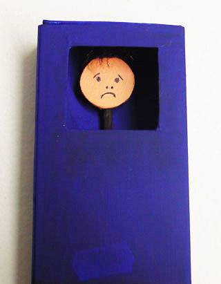
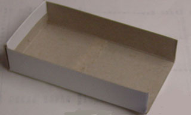

Maak je eigen stemmingspoppenkastje en laat daarmee aan je moeder of vader (of meester of juf of weet ik wie) zien of je een goed humeur hebt, of kwaad bent, of verdrietig, of onzeker.
 Zeg met je popje wat je op je hart hebt en je zult zien: dat is veel gemakkelijker dan het zelf te zeggen. En als het uit de hand loopt, kun je er niks aan doen. Tenslotte zei jij het niet, maar de pop!!
 Of laat je sjagrijnige popje praten met je vrolijke popje. Soms hoor je dan dingen die je nog niet wist over jezelf.

 Je hebt een grote lucifersdoos nodig.

 Verwijder van de binnendoos het tussenschotje en knip een korte kant eruit.

 Knip uit de buitendoos een raampje en schilder de buitenkant van de buitendoos en de binnenkant van de binnendoos. Je kunt het natuurlijk in verschillende kleuren doen en versieren, het hoeft niet zo saai te zijn als ik het gedaan heb.
 Voor de poppetjes heb je dun karton en een sate-prikker nodig. Trek per poppetje de omtrek van een 1 Euro-stuk 2x om en knip uit. Als het karton geen huidkleur heeft kun je het schilderen. Teken de gezichtsuitdrukking  erop. Plak de twee helften op elkaar met de sateprikker ertussen.
 Versier eventueel.
 Zijn er nog meer stemmingen die je kunt maken dan de 4 die ik hier laat zien (denk aan smiley's!)?
 Ik hoor graag of je geexperimenteerd hebt met aan iemand te vertellen hoe je je voelt. Mail naar: info@(dit weglaten)peterselie.nl. En dat stukje tussen haakjes moet je dan dus weglaten (dat is tegen spam).
