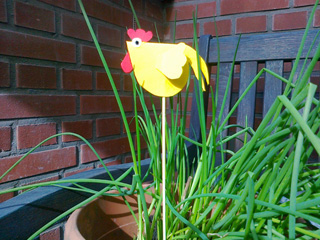

Klik op het patroon voor een vergroting.

Nodig: geel (of een andere kippenkleur) karton
 restjes rood, wit, zwart karton
 sate-prikker
 lijm, plakband, schaar

Vouw geel karton dubbel en knip de kippenvorm dubbel uit. Knip alle andere vormen uit. Knip de opening in de vouw van het kippenlijf zoals aangegeven en lijm daar de kam in. Lijm de rest op de kip. Plak de sate-prikker aan de binnenkant van het lijf en plak de andere lichaamskant ook op de prikker.

Dit komt uit het blad Oerrr van Natuurmonumenten en werd daar gebruikt als windvaantje. Plak ipv de prikker een balpen-dop in het lijf en zet het geheel vervolgens op een sate-prikker. De kop geeft de richting aan waar de wind vandaan komt.
