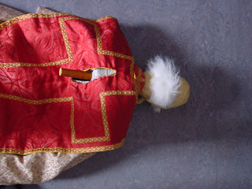
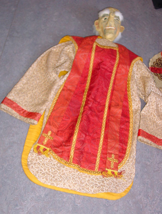
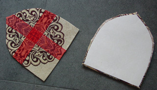

Werkwijze:

 Maak een bol van oude kranten en zet deze op een stok vast met schildersplakband.

 Plak laagjes papiersnippers op de bol met behangerslijm. Ik gebruik zelf graag houtlijm, maar dat werkt tamelijk moeilijk. Nadat de eerste laag droog is, met schildersplakband oren (karton) en neus (kurk) goed vastzetten. Extra laagje papiersnippers op de overgangen. Druk plek voor ogen en mond wat in vorm en plak er oogleden/lippen overheen.
 Plak in totaal 3 laagjes papiersnippers op de kop.

 Schilder met acrylverf en plak na het drogen eventueel ogen in.

 Schouders van stuk schuimrubber in vorm knippen (de snippers die hier vanaf komen zijn goed vulmateriaal voor andere poppen).  In het midden een gat erin steken met schroevendraaier. Doe lijm op stok en schuif schouders eraan.

 Gebruik voor het lijf (het patroon van) een t-shirt of overhemd.

 Maak een gleuf aan de achterkant van de mouw ter hoogte van de elleboog. Midden op de rug kan ook een verticale gleuf worden gemaakt om de stok gemakkelijker te bedienen:

 Tja, dit wordt moeilijker: ik vond dit gewaad op een rommelmarkt.......

 Knip 2x een halve mijter van karton en plak daar de mijter-stof (met zoom) op.

 Stof eromheen trekken en vastnaaien. Extra laag karton (iets kleiner) op de achterkant van iedere mijter-helft plakken.Aan de onderkant de twee mijterhelften met een paar steken aan elkaar vastmaken.

Hierbij een filmpje, waarin onze "Paus" het gedicht "The Poems of the Pope" van de Chileense dichter [Nicanor Parra](http://www.nicanorparra.uchile.cl) illustreert, gedeclameerd door [Robert Beltran](http://www.robertbeltran.com) (beter bekend als Chakotay uit de Startrek-serie Voyager):

<iframe src="https://www.youtube.com/embed/8diQBcKChKY" width="480" height="360" frameborder="0" style="position:absolute;width:100%;height:100%;left:0" allowfullscreen></iframe>

