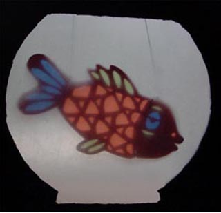

Poppentheater Peterselie streeft ernaar om voorstellingen te geven "die er toe doen".
 De voorstellingen zijn dus niet alleen leuk of mooi (dat natuurlijk ook!), maar gaan verder dan dat.
 Soms is er een (niet expliciete) boodschap, bijv. bij een "groene" voorstelling, of het nevendoel is om kennis te maken met klassieke muziek. Soms is bijv. het inleven in een ander het doel, of simpelweg actieve concentratie.
 Peterselie hecht ook veel belang aan taal: aan mooie, begrijpelijke taal, en aan het jezelf kunnen uiten via woorden.

Bij de peutervoorstellingen geldt dat ze vrijwel allemaal gemaakt zijn naar aanleiding van een bekroond prentenboek. Om het  voorlezen te bevorderen werd de Kiekeboekprijs en daaraan gekoppeld de Peutermaand bedacht. Later werd dit het Prentenboek van het Jaar, waaraan aandacht wordt besteed tijdens de [Nationale Voorleesdagen](http://www.denationalevoorleesdagen.nl).
 Poppentheater Peterselie gebruikt deze boeken al meer dan 20 jaar als inspiratiebron  en maakt daar rondomheen een zeer interactieve voorstelling met liedjes en  bewegingsspelletjes, waarbij aan de woorden extra lading wordt meegegeven van (zintuigelijke) ervaringen en emoties.
 Hierdoor blijft zelfs een peuter 3 kwartier geconcentreerd en weet soms jaren later nog wat er in de voorstelling gebeurde.
 Poppentheater Peterselie geeft workshops voor volwassenen met als doel poppenspel populairder te maken als hulp bij taalbevordering. Kijk [hier](http://www.peterselie.nl/prentpoptaal) voor meer informatie.

Hier staat een [link](https://www.peterselie.nl/files/Vertellen%20met%20extra's_artikel.pdf?fbclid=IwAR3yF435pgD-bA2ZG8oaUx1r6J5EfhrFe5IgCk4aLkqqzsVhht7J2kmmXKw) naar een artikel dat ik ooit geschreven heb over het vertellen met extra's.

 Visje, visje, in het water.....
 visje, visje, in de kom.
