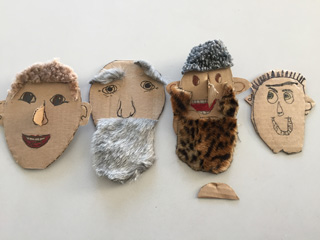
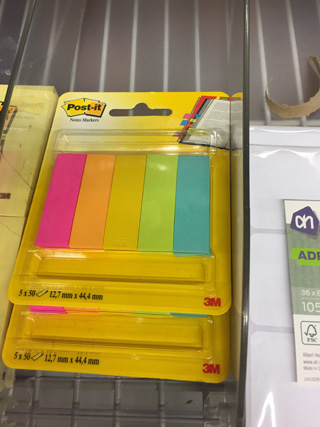

Eenvoudig te maken basispop, die door de client in zeer korte tijd kan worden gepersonificeerd.

Bij familie opstellingen kun je denken aan een heel aantal van deze poppen, met neutrale koppen, voor het grotere familieverband. De naaste familieleden kunnen dan met een paar eenvoudige knutselhandelingen preciezer worden aangegeven.

 
Neutrale pop.

Nodig: 
Een heel aantal lege plastic flessen in allerlei formaten (met dop), zand of kleine kiezelsteentjes (30 kg. voor 3 Euro bij een bouwmarkt) voor de stabiliteit, verf/karton/stof voor de kleedjes, stevig verpakkingskarton voor hoofden en eventueel handen, eventueel lollie- of ijscostokjes, viltstiften, lijm, schaar, breekmesje, allerlei knutselmateriaal.

in plaats van dozenkarton voor de koppen kun je ook blanco bierviltjes gebruiken, die verder op dezelfde manier bewerkt worden. Per 100 stuks kosten die €6,95, bij hogere aantallen minder. O.a. te koop bij www.viltjes.nl

 
Vul de flessen met zand of kiezels. Handiger is het om dit te doen nadat het jurkje is aangebracht.

 
Sluit de fles na het vullen af met een dop. In de dop een gat maken als er een lolliestokje achter de kop wordt geplakt, bij ijscostokjes of kartonnen stroken een gleuf.

 
Schilder de fles met acrylverf, beplak met gekleurd karton of lijm er een dun stofje omheen.

 
Laat de client op ruim uitgeknipte vierkantjes van dozenkarton gezichten maken van naaste familieleden.

 
Mochten er helemaal geen knutselmaterialen aanwezig zijn, dan kunnen bijvoorbeeld haren van Post-it papiertjes worden gemaakt.

 
Plak de kartonnen strook of het stokje aan de achterkant van het hoofd en steek het hoofd in de dop.

 
De poppen kunnen nu opgesteld worden.

 
Maak eventueel nog armen en handen of bevestig een rok.

Met dank aan de Kleinkinderen.
