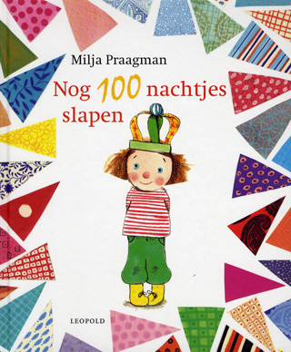
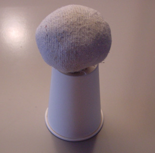
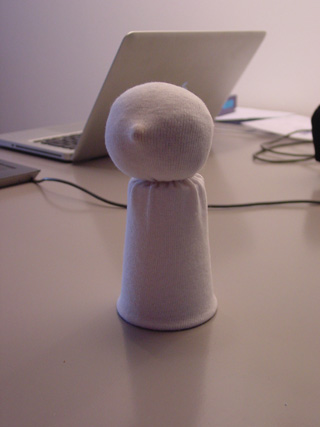
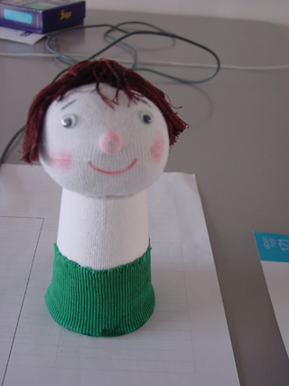

Vul een stuk tricot (of een teen van een sok) tot een bal.

Maak gat in bodem van een papieren bekertje. Stop het uiteinde van de tricot bal door het gat. Verstevig eventueel met kloddertje lijm.

Trek een sok over het hoofd, stop daar een kraal in voor de neus. bind de nek af en knip af langs de onderkant van het bekertje. Plak daar de sok vast. Gebruik wasknijpers tot het droog is.

Bind een draadje om de neus of rijg er eerst omheen en trek de draad aan en zet vast. Maak haar door wol oid om de hand te wikkelen, aan 1 kant lost te knippen en in het midden vast te binden. Plak op het hoofd. Plak een paar wiebelogen op de juiste plaats. Maak wangen en neus rood. Teken een mond.
 Plak de "broek" op de onderkant van het bekertje (zie patroon). Bij niet goed rekbare stof het patroon wat verlengen.

Plak het hemdje op (of rijg het en trek rondom het nekje aan), plak de armen dubbel. Knip 2 handjes uit vilt of dun schuimrubber en plak er tussen. Plak de armen op de juiste plek.
 Knip uit dik schuimrubber de voetjes. Rond de bovenkant af, verf geel en plak ze als ze droog zijn, tegen het bekertje aan.
 Maak een kroon van stukjes karton.

[Patroon100nachtjes.jpeg](https://peterselie.nl/files/Patroon100nachtjes.jpeg "Download: Patroon100nachtjes.jpeg (164.12 KB)")
 Druk patroon af op A4-formaat.
