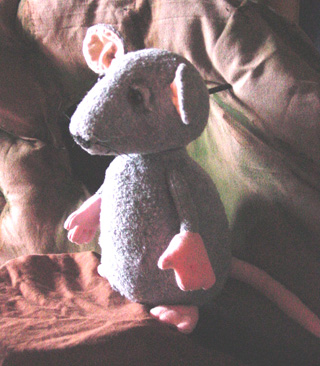
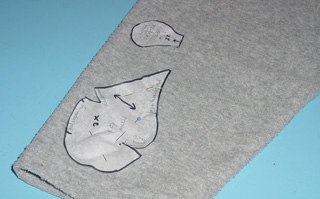
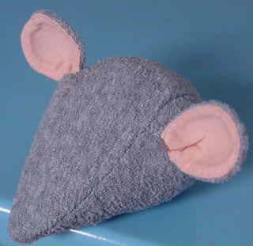
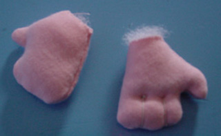

 
Hoe maken we Muis? 
Neem de onderdelen van het [patroon](/patroonmuis) over op doorzichtig papier. 
 
Leg alle delen (behalve het lijf) op tricot stof (bijv. een tweedehands t-shirt). Let hierbij op de draadrichting. Knip het tussenkopstuk en de staart  van enkele stof, de kopzijkant en het been 2x, de oren, handen en voeten en armen 4x. Bedenk welke delen je grijs en welke je roze wilt maken. Houd 0,5 cm naad aan. 
 
Stik de oren, laat de onderkant open en keer en strijk ze. Leg in het midden een plooitje en naai dit met een paar steken vast. Stik de oren tussen de opengeknipte zijdelen van de kop. Stik de coupenaden in de zijdelen. Stik het middendeel van de kop aan de zijdelen. Laat aan de onderkant een stukje open voor het vullen. Stik de naad onder de snuit dicht. Vul en naai dicht. 
 
Steek ter hoogte van de ogen een draad een paar maal door de kop (van oog naar oog), trek stevig aan en hecht af. Plak of naai  in de ontstane holten de ogen (gekochte of zelfgemaakte van vilt). Een half maantje van vilt als ooglid boven de ogen plakken. 
 
Uit een stuk schuimrubber van ongeveer 8 cm dik (bijv. uit een oude matras) het lijf volgens patroon snijden met een breekmesje. Met de schaar ronde hoeken maken. 
 
Vouw het lijf in een stuk tricot. Knip af met zo weinig mogelijk overlap, en speld het netjes rondom. Schuif er aan de onderkant een (afgerond) stuk loodslab in zo groot als het sta-vlak. Loodslab is te koop bij een bouwmarkt. 
Naai met fijne steekjes de stof om het lijf, dan vallen de naden helemaal weg. 
 
Naai de kop op het lijf, rondom de nek met een [flanelsteek](</files/De Flanelsteek.doc>). 
 
Naai handen en voeten, draai om, vul en geef de vingers aan met knoopsgatgaren (eerst door en door steken bij de basis van vingers/tenen, dan buitenlangs naar de andere kant). 
 
Naai het been op de zijkant van het lijf, laat aan de onderkant een stukje open, vul en zet de voet eronder vast. Naai de staart, keer om, vul en zet op de juiste plek. 
 
Naai de armen, neem de maat (maak eventueel wat korter als dit beter lijkt), zet de handen eraan. Prik de armen vast op de juiste plek op het lijf. Neem een hele lange naald en ga met knoopsgatengaren een paar keer heen en weer door bovenkant armen en lijf, zodat de armen nog naar voren en naar achteren kunnen rond dit draaipunt. 
 
Als het de bedoeling is om met de pop te spelen, kan een stokje achter in het hoofd worden gelijmd voor de beweging. Om het niet op te laten vallen, maken we het zwart met een viltstift. 
 
Maak snorharen en geef her en der wat kleur met lippenstift en ogenpotlood. 
En zo wordt ie dan! 
Met dank aan Wil van der Spiegel voor het patroon voor de kop, te vinden in het boek: "Muizen en ander volk".
