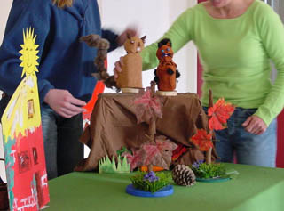

WORKSHOP TAFELPOPPEN
 Deze workshop (1,5 tot 2 uur) is geschikt voor allerlei groepen, zoals personeel in de kinderopvang, kindercoaches, studenten PABO en agogische opleidingen, studenten Zorg & Opvang, groepjes ouders die het thuis willen gaan proberen enz.
 Er wordt eerst een stukje theorie gegeven over het belang van vertellen en van de verteltafel hierbij, en hoe vertellen nog verrijkt kan worden dmv expressie, zintuiglijke ervaringen en natuurlijk: poppenspel. Ook is er een "tentoonstelling" over allerlei soorten eenvoudig te maken tafelpoppen.
 Voor materiaal kan worden gezorgd.
 Prijs excl. BTW en reis: €175,- (incl. werkboek)

VAN PRENTENBOEK TOT TAFELVOORSTELLING
 Workshop van een dag.
 Met als uitgangspunt een prentenboek worden tafelpoppen gemaakt en wordt gekeken hoe je het verhaal het beste kunt omwerken tot een effectieve poppenvoorstelling.
 De nadruk komt daarbij te liggen op handeling  en beweging (het "levend" maken), eventueel versterkt door decor, geluid, muziek en licht.
 Aan het eind van de dag kan een voorstelling worden gespeeld voor publiek (kinderopvang/peuterspeelzaal o.i.d.).
 Prijs: vanaf €275,- excl. BTW en reiskosten (incl. werkboek)

EEN SPROOKJE VERTELLEN MET TAFELPOPPEN
 De tafelpoppen die we in de workshop gaan maken hebben als basis plastic flessen, bekers en bakjes en als kop een gedeeltelijk opgevulde sok. We werken met sprookjesfiguren en bekende sprookjes als leidraad.
 Bij de uitvoering van het tafelspel is er theaterlicht en een achterdoek om het "echter" te maken.
 Van de presentaties wordt een opname gemaakt, die leerlingen en belangstellenden op Youtube kunnen zien.
 Prijs: €275,- excl. BTW en reiskosten, incl. werkboek

<iframe width="320" height="315" src="https://www.youtube.com/embed/NVxyUekpIIQ" frameborder="0" allowfullscreen></iframe> 
Roc Emmeloord 2010

 Kartonnen verteltafelfiguren.

KARTONNEN FIGUREN OP DE  VERTELTAFEL
 Zelf binnen een dagdeel een prentenboek op de verteltafel spelen? Dat kan! Met een groepje maakt u alle tafelpoppen en decortjes en krijgt u ook les in het uitspelen van het verhaal. Verder is er een stukje theorie over de verteltafel en de mogelijkheden van poppenspel bij het vertellen.
 Als voorbeeld [hier](/tafeltheater) de patroontjes van de voorstelling "Mama kwijt" (zie foto hierboven).
 Prijs €175, excl BTW en reis, incl. werkboek.

Kijk voor andere voorbeelden van tafelpoppen bij: [Kerstpoppen maken](/kerstpoppenmaken) en bij [Tafelpop Muis](/tafelpopmuis)
