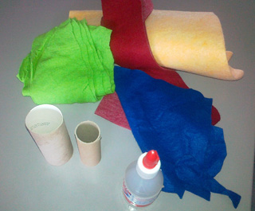
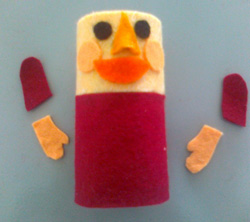

 
Wat heb je nodig? 
\- rol van karton (zelfgemaakt of een wc-papier-rol enz.) 
\- vilt (in ieder geval ook in gezichtskleur) 
\- schaar 
\- lijm

 
Beplak 1/3 van de rol met vilt in gezichtskleur, de rest in een kleur die je mooi vindt.

 
Maak van stukjes vilt een gezichtje. 
Knip armpjes en handjes en plak die aan de zijkant.

 
Knip stroken haarkleurig vilt aan 1 kant in en plak op de juiste plaats. 
Knip voetjes met een plakstrook en plak die om de onderkant van de rol. 
Maak een mutsje van 2/3 van een  cirkel vilt (gebruik voor de vorm een schoteltje). Plak aan achterkant dicht (of naai het) en plak op pop.

Je kunt natuurlijk in plaats van vilt ook gekleurd papier of karton gebruiken en allerlei andere knutselmaterialen voor de aankleding (wiebelogen, kralen, knoopjes, wol enz.).

Zet je de foto van je kabouter op [de Facebook-pagina van Poppentheater Peterselie](https://www.facebook.com/PoppentheaterPeterselie)?
