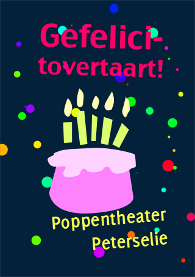
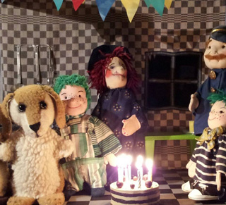

Helaas, deze voorstelling wordt niet meer door mij gespeeld, maar is verkocht!

Vrolijke poppenvoorstelling over het verjaardagsfeestje van Pien Peterselie.

Piet heeft gezorgd voor de slingers en heeft een tekening voor Pien gemaakt, Pien heeft een taart gebakken. En wij zingen met zijn allen natuurlijk "Lang zal ze leven!", bij de trekharmonica.
 Pien moet nog even limonade halen in de winkel en Piet zal de verjaardagsgasten gaan uitnodigen: Politieagent, Hond en Schaap. Wie het eerste weer thuiskomt, krijgt een extra stuk taart.
 Maar dan komt Hellevella, de Heks, om de hoek kijken........
 Oei, als dat maar goed afloopt!

Natuurlijk heel geschikt voor verjaardagsfeestjes!
 Leeftijd: 4 t/m 7 jaar (absoluut niet ouder!)
 Maximum aantal kinderen bij een verjaardag: 15, bij een "gewone" voorstelling 45.
 Prijs (zonder theaterlicht en geluidsinstallatie): 150 Euro (alleen voor verjaardagen thuis. Voor alle andere gelegenheden geldt de normale prijs).
 Klik [hier](/affichetovertaart) voor een affiche.
 Er kunnen kleurplaten worden uitgedeeld.

