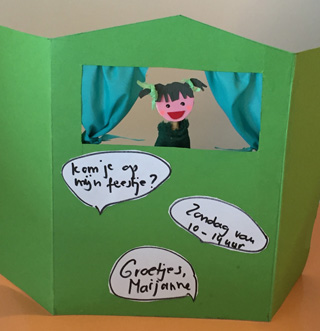
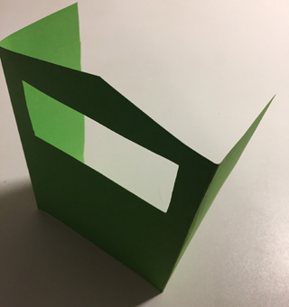

Met deze uitnodiging kun je echt poppenkast spelen!

Leg een A4'tje in de breedte voor je.
 Vouw de smalle kanten aan beide zijden 7,5 cm om. Door met een breipen langs een lineaal deze vouwlijn in het karton te "krassen", wordt het vouwen eenvoudiger.
 Dit zijn de zijkanten, waardoor de poppenkast goed blijft staan.
 Knip van de bovenkant van de 'zijkanten'  2 centimeter af (maak ze dus 2 cm lager dan het middengedeelte).
 Neem van de bovenkant het midden en knip van daaruit schuin
 naar beneden, tot de hoogte van de zijkanten.
 Knip dan het speelvenster (raampje) uit.
 Dit is een rechthoekig gat in de bovenste helft van de voorkant.
 Als je één poppenkastje hebt gemaakt, heb je een malletje voor de andere uitnodigingen.
 Even met potlood omtrekken, uitknippen en klaar alweer!

Plak een uitgeknipt hoofd (foto van de jarige of
 van een getekend popje, getekend door de jarige?)
 op een ijslolliestokje en bevestig dit stokpopje met
 schilderstape aan de binnenkant vast (dat is er gemakkelijk weer af te trekken).

Maak tekstballonnetjes op de voorkant van het kastje, met daarop de datum, plaats, en tijd van het feestje.
 Laat de bijna-jarige de poppenkastjes met mooi papier, viltstiften, stickers of glitters versieren.
 Er kunnen ook gordijntjes van papier of echte stof in geplakt worden.

