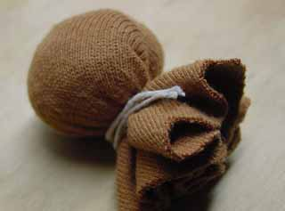

 Wat heb je nodig?
 \- kartonnetje van 15 x 10 cm
 \- een rondje van tricot (rekbare) stof in huidkleur, zo groot als een klein schoteltje
 \- vulling
 \- katoenen draad
 \- lapje stof of vilt van 15 x 10 cm om het kokertje te bekleden
 \- lijm
 \- schaar

Hoe maak je het vingerpopje?
 Rol het kartonnetje op, zodat je vinger erin kan. De onderkant moet wat wijder zijn dan de bovenkant. Zet vast met plakband of crepetape. Knip de uitstekende stukjes van de onderkant af.

Leg wat vulling in het midden van het tricot rondje (een teen van een kindersok is ook heel gemakkelijk) , vouw de tricot eromheen en bind het dicht met een draadje katoen.

Stop het als een hoofdje in het tricot kokertje en lijm het vast.
 Beplak het kokertje met een stukje stof, papier of vilt.

Maak haren van bont en teken ogen en mond erop met viltstift.
