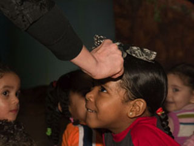

 Foto: Saskia de Jong

Heel belangrijk bij de voorstellingen van Peterselie is de "ontmoeting" met het publiek.
 Interactie staat centraal. En daarmee wordt niet bedoeld: "ja" en "nee" gillen, maar meezingen, meebewegen, meedenken en soms ook daadwerkelijk meespelen. Bij de beschrijvingen van de voorstellingen staan filmpjes die dit laten zien.

De vorm, de inhoud en de sfeer van een kindervoorstelling moet goed aansluiten bij de ontwikkeling van het kind, wat niet inhoudt dat er geen appèl wordt gedaan op nog niet ontwikkelde vermogens.
 Het kind moet zich veilig voelen en serieus genomen worden, zodat het zich helemaal kan overgeven aan het verhaal. Vandaar ook: navoelbare emoties, geen grapjes "over de hoofden van de kinderen heen" en heel veel interactie met het publiek.
 Het verhaal moet niet te abstract zijn en niet teveel overbodige prikkels afgeven. Het moet leuk en spannend zijn, en er moeten geen onduidelijke losse eindjes overblijven: alles moet kloppen.

Meezingen, muziek maken en meebewegen zijn in vrijwel iedere voorstelling terug te vinden, en natuurlijk zijn de voorstellingen van Peterselie ook mooi om naar te kijken.

Door deze elementen ontstaat een concentratie die enorm belangrijk is voor de ontwikkeling. Dit kan nog versterkt worden als de aanwezige begeleiders en ouders ook meeleven met het verhaal. Om het uiterste uit een voorstelling te halen staan er elders op deze site [tips](/voorstellingtips).

Wie luistert naar de 6-jarige Peterselie ([orgel.mp3](https://peterselie.nl/files/orgel.mp3 "Download: orgel.mp3 (831.45 KB)"))
 voelt wel aan dat het taalgebruik verzorgd is en er niet wordt gevloekt.

Klik hier: [interview.m4a.zip](https://peterselie.nl/files/interview.m4a.zip "Download: interview.m4a.zip (51.31 MB)") voor een interview op Radio IJsselmond voor het programma Cultuurvreters.
