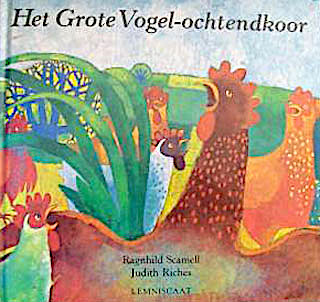
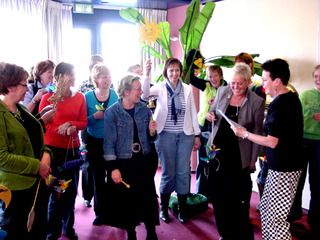

Deze meedoe-voorstelling wordt helaas niet meer gespeeld.

We gaan uit van  eenvoudige vogel-klapbekpoppen waar we onze creativiteit volledig op kunnen botvieren en spelen aan het eind het verhaal "Het vogelochtendkoor" uit met onze eigen poppen. Er zijn nog wat solo-rollen met poppen, die meegebracht zijn door Peterselie.

Voor een groep (niet groter dan 15 personen) kost deze meedoe-voorstelling €275,- excl BTW en reiskosten.
 Peterselie zorgt voor alle materialen, poppen en attributen.
 Als hieraan voorafgaand de lezing ["Prent+Pop=Taal"](prentpoptaal) wordt gegeven, is de totaalprijs €375,- excl. Hierbij zit dan ook een tentoonstelling over zelf te maken zeer eenvoudige poppen.
