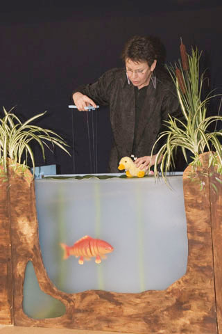

 Poppentheater Peterselie tijdens "Alle eendjes......"
 Foto: Saskia de Jong

VOORSTELLINGEN

**Update: Alleen de nog vertelvoorstellingen, meespeelvoorstellingen en workshops/lezingen kunnen nog geboekt worden**

Poppentheater Peterselie speelt 2  [peuter-/kleutervoorstellingen](/peuterkleutervoorstellingen), 3 interactieve [kindervoorstellingen (4+)](/kindervoorstellingen), een [kerstvoorstelling](/kerstvoorstelling),  en diverse [meedoe-voorstellingen](/meespeelvoorstellingen).

Voor de liefhebbers kunnen foto's en filmpjes van voorstellingen uit het verleden bekeken worden op
[archiefvoorstellingen](/archiefvoorstellingen).

Een groot deel van de voorstellingen is erg geschikt voor [mensen met een beperking](/verstandelijkebeperking).

Een nieuwe voorstelling voor [volwassenen](/volwassenen) "De Boodschapper" is in de maak.

En....natuurlijk speelt Peterselie ook op [feestjes](/feestjes)!

Als u een poppenvoorstelling wilt boeken, is het handig om in de [speellijst](/speellijsten) te kijken, of de datum nog vrij is.
 U kunt een vrijblijvende optie nemen op een datum. Deze optie blijft 14 dagen geldig. Het is fijn als u ook laat weten als de optie niet omgezet wordt in een opdracht.
 Als alle gegevens voor een boeking bekend zijn, wordt een overeenkomst in tweevoud toegestuurd, waarvan er één getekend teruggezonden moet worden om de opdracht officieel te maken. Lees [hier](/algemenevoorwaarden) de Algemene Voorwaarden.
 Na de voorstelling ontvangt u een factuur.
 Peterselie werkt niet via een artiestenbureau, dus: kortere lijnen, minder overhead-kosten.
[Hier](/wiezaldatbetalen) staan een paar ideeën om aan het benodigde bedrag voor een voorstelling te komen.
 Om de voorstelling zo prettig mogelijk te laten verlopen, zijn hier wat [tips](/tips).
 U kunt het geld dat u misschien aan een bloemetje  had willen besteden, ook geven aan de actie ["Bosje bloemen of bosje peterselie?"](/bosjepeterselie). Dit geld wordt dan besteed om voorstellingen voor bijvoorbeeld zieke kinderen mogelijk te maken.

Van de voorstellingen kan digitaal een affiche worden toegestuurd/gedownload!
 Van een paar voorstellingen staan [hier](/persfotos) persfoto's.

Voor technische gegevens: klik [hier](/techniek).

 Peterselie treedt op bij trouwen oudste zoon Boris.

 Natuurlijk met een pop.

Like PP op [Facebook](http://facebook.com/poppentheaterpeterselie)!
