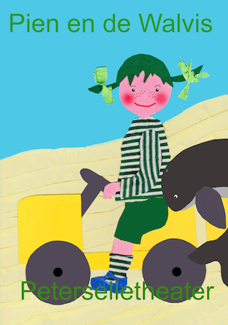
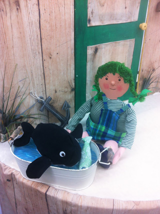
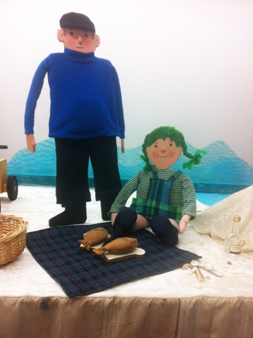
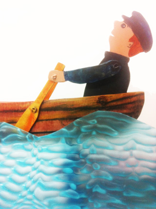
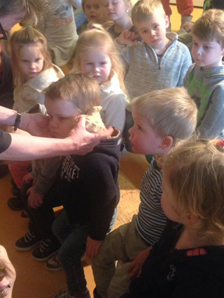

Helaas, deze voorstelling is verkocht aan een andere poppenspeler.

Pien woont met haar vader in een huisje vlak bij het strand. Ze voelt zich vaak alleen, omdat haar Vader de hele dag van huis is om te vissen. Dan is er alleen de Poes, maar die is enkel geïnteresseerd in de vis die Vader 's avonds mee naar huis brengt. 
Als ze na een storm op het strand aan het rondkijken is, wat er is aangespoeld, vindt ze een kleine Walvis. 
Ze neemt hem mee naar huis en stopt hem in haar zwembadje achter het huis en hoopt dat Vader hem niet zal vinden. 
Maar ja, dat gebeurt natuurlijk toch en dan brengen ze hem samen weer naar zee, omdat walvissen in de zee horen. 
Vader heeft nu wel door, dat Pien hem vaak mist en probeert vaker thuis te zijn. Dan gaan ze picknicken op het strand en kijken of ze walvissen zien.

Interactieve vertelvoorstelling met poppen voor de Voorleesdagen 2017, losjes gebaseerd op het bekroonde boek Kleine Walvis, van Benji Davies. 
Klik [hier](/affichewalvis) voor een affiche. 
Klik [hier](/liedjeswalvis) voor de liedjes.

Prijs: €325 excl. 6% BTW en reiskosten 
Volgende voorstellingen (zelfde dag, zelfde plek) €175 excl. 
Ongeschikt voor zalen met een podium, het mooist in een vlakkevloer-theater 
In verband met zicht: kinderen op bankjes, niet op de grond 
Benodigde ruimte voor het decor: 4x3m 
Geschikt voor kinderen van 3,5 tot 7 jaar 
Ideale aantal kinderen: 40, met ouders: 60 
Duur: 25 tot 35 min. 
Opbouwtijd: 1,5 uur 
Afbreektijd: 45 min

 
....Hoor je de zee wel ruisen in de schelp?....

