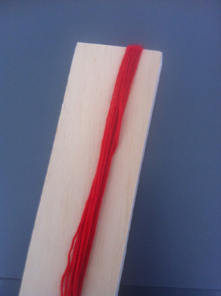
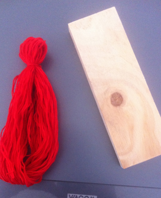
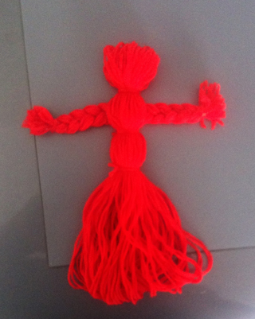
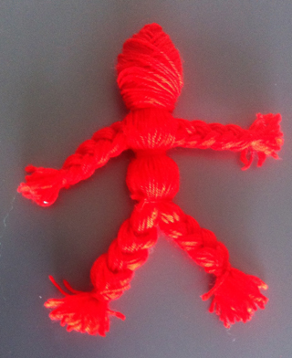

 Vertel aan deze "worry doll" je zorgen en leg hem daarna onder je kussen. Je externaliseert hiermee je problemen en ligt er niet meer wakker van.
 Voor meer informatie en achtergrond:
[Wikipedia Worry Doll](https://en.wikipedia.org/wiki/Worry_doll)

 Wind wol om een niet te lang plankje of stuk stevig karton.

 Als je een lekker bosje hebt gewikkeld, schuif je het eraf en maak je nog een bosje.
 Op ongeveer 1/5 een hoofdje afbinden met een draadje wol.

 Van het andere bosje een vlechtje maken. Je kunt het vlechten gemakkelijker maken door één uiteinde met een draadje aan een deurkruk o.i.d. te binden. Knip het andere uiteinde door. Bind de beide uiteinden af als handjes. Stop het vlechtje net onder het nekje door het lijf van de pop. Bind daarna de taille af.
 Ik heb nog een soort heupen gemaakt, maar dat hoeft niet.

 Eventueel 2 beentjes vlechten, maar voor het wikkelpopje hieronder is dat niet nodig.

 Het hoofd wordt een echte schedel, als je het stevig inwikkelt. Bovendien heeft wikkelen een soort meditatieve functie, wat het wens-karakter van de pop ten goede kan komen.

 Je kunt er een gezichtje op maken als je dat prettig vindt. Dit kan door er stukjes vilt of kraaltjes op te plakken, maar ook door een apart gezichtje te knippen uit vilt (in dit geval een 1000-dingen-doekje), op te plakken en als het droog is met een viltstift te betekenen, met een vleugje lippenstift op een vingertop voor de wangen.
 Haar kun je maken door wol om 2 vingers te wikkelen, er af te schuiven, in het midden af te binden en de uiteinden door te knippen. Op het hoofd plakken of naaien. Het kan natuurlijk ook een stukje bont of raffia zijn.

 Zoek lapjes uit, waar je iets mee hebt (echt je smaak, of misschien zelf gedragen) en wikkel deze om de pop met touwtjes, bandjes enz. Versier eventueel met knoopjes, kraaltjes of  kleine voorwerpjes. Maak het popje tot echt iets van jezelf of voor de persoon (het angstige kind) waarvoor het bedoeld is.

 De wenspop moet goed verzorgd worden. Laat hem niet zomaar slingeren, maar bewaar hem op een vaste plek of in een eigengemaakt "bedje", als je hem even niet nodig hebt om je zorgen aan toe te vertrouwen. Deze pop ligt in een grote lucifersdoos, beplakt met mooi papier.

Kan ook zonder vlechtjes in armen en benen.

