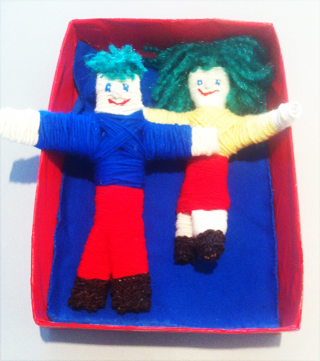
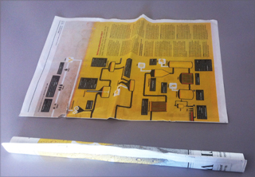
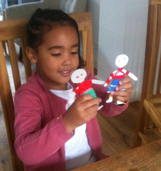

Zoals al eens eerder gezegd: het ritmisch wikkelen maakt de meesten van ons meditatief en daardoor zouden we gemakkelijker onze intenties op de pop kunnen projecteren, wat natuurlijk de bedoeling is bij een Wenspop!

Vaak is het idee dat je allerlei materiaal moet aanschaffen een reden om niet aan een pop (of ander project) te beginnen.
 Het is dus stimulerend als de materialen al in het huis aanwezig zijn.
 Voor dit popje heb je krantenpapier (tabloid-formaat) nodig, restjes wol, eventueel plakband en lijm, stevig draad om te binden en een schaar.

 Rol 2 dubbele pagina’s op in de lengte. Plak eventueel met plakband vast.

 Rol vervolgens 1 dubbele pagina op in de breedte.

 Vouw de lange rol dubbel in een V-vorm.
 Steek de korte rol door de V en bind of plak ze met plakband vast in de vorm van een lijf.

Het Grote Wikkelen kan nu beginnen!
 Begin bij hoofd en handen, zodat de “kleren” er overheen komen.
 Voor kinderen en minder ervaren knutselaars is het handig om de draad bij het begin met een plakbandje vast te zetten. Je ziet daar niets van, want je wikkelt  erover heen.
 Als er een stuk klaar is, stop je het draadje met de punt van de schaar onder de rest van het wiksel.
 De handjes en voetjes zijn moeilijk om helemaal in te wikkelen. Ik smeerde het papier van handen en voeten (1 voor 1!) in met hobbylijm alvorens ze te wikkelen en zette de gewikkelde draden op de uiteinden  ook nog eens extra vast met lijm.

Teken, naai of plak ogen, neus en mond op het hoofdje.
 De haren heb ik gemaakt door wol om mijn vingers te wikkelen, in het midden vast te knopen, de uiteinden los te knippen en ze op het hoofd te plakken.

In plaats van alles te wikkelen, kunnen er lapjes als kleren worden gebruikt.

Zorg weer voor een mooie opberg-plaats. Beschilder of beplak  bijvoorbeeld een kartonnen doos (bovenste foto).

 Voor kinderen is het gemakkelijker om gezicht, handen en voeten bloot te laten.
 Deze popjes zijn gemaakt van karton in plaats van krantenpapier. Ik vond de foto op het Internet.

 Je kunt ook een compleet poppetje uit karton knippen.
 Voor 4-jarig Kleinkind was het wikkelen om een kant en klaar uitgeknipt figuurtje nog een hele klus...
