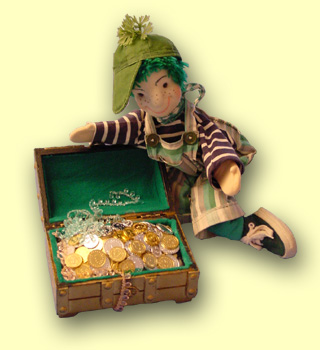

SAMENWERKEN MET ANDERE ORGANISATIES
 Als het theater 1 voorstelling bij u komt geven, zijn de reiskosten relatief hoog. Als u een andere instelling bij u in de buurt ook weet te interesseren, kunt u die delen. Nog goedkoper wordt het, als de voorstelling op één plek kan blijven staan, omdat de prijs van een tweede keer spelen aanzienlijk lager is.

TAALSTIMULERING
 De meeste voorstellingen van Peterselie gelden als taalbevorderend. Gemeentes hebben hier vaak een subsidiepotje voor.

KORTING
 Voor kleine groepjes zijn er kortingen op de voorstellingen van Poppentheater Peterselie te bedingen, kijk bij [korting](/korting).
 Ook valt er soms een deal te maken als er een goede video-registratie wordt gemaakt van de voorstelling.

RUILEN?
 Poppentheater Peterselie is bezig een boerderij te verbouwen.  Voor de tuin zijn diverse inheemse struiken en vruchtstruiken/-bomen nodig. Als u struiken kunt leveren, zijn er kortingen mogelijk.

KINDERKERMIS
 Kinderen en/of hun ouders kunnen met elkaar een kermis opzetten en bemannen. Probeer er winkeliers uit de buurt bij te betrekken voor prijzen voor een loterij (reclame ophangen?).
 Een koffiekraam met zelfgemaakt gebak erbij brengt ook geld in het laadje.
 Of denk aan een stekjesmarkt.
 De opbrengst kan gebruikt worden voor een voorstelling.
