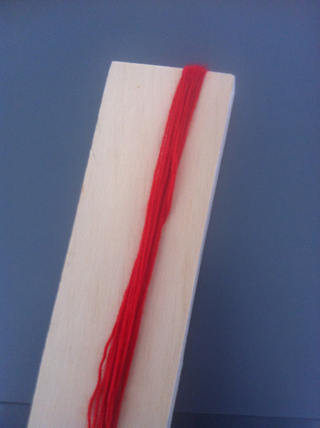
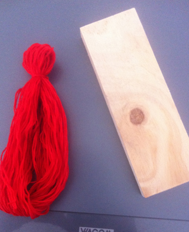
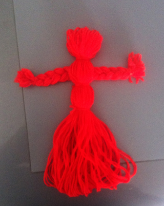
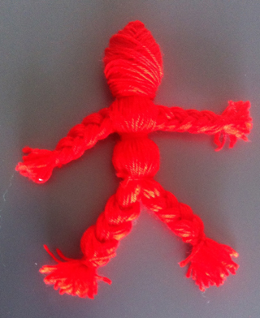

 Tell your troubles to the doll and hide it under your pillow. Because you externalised your troubles you will have an worry-free night.
 More information:
[Wikipedia Worry Doll](https://en.wikipedia.org/wiki/Worry_doll)

 Wrap wool around a piece of wood or heavy carton.

 Take the wool off. Tie off at 1/5 of the length. This is the head.
 Wrap another bundle.

 Cut one end  of the other bundle and braid. You can make this easier by tieing one end to a doorhandle.
 Make two hands. Put the arm through the body and tie off beneath.
 You can make hips, if you want to, but it is not necessary

 If you like, you can give two legs to the doll as well.

 Wrap  wool around the head to make it sturdier.
 Wrapping  has a  kind of meditative function, which can influence the wishing aspect of the doll.

 You can glue a face on it.  This one is cut from a cleaning rag.
 For hairs you use wrapping  again, now around 2 fingers. Glue or sew it on.

 For clothes use materials that you really like, of have worn yourself. Use pieces of string, beads, buttons.

 Take good care of your Wishing Doll. Give it a nice place to stay, when you do not need it. I put it in a large matchbox.
