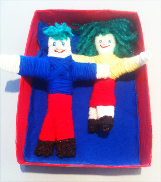
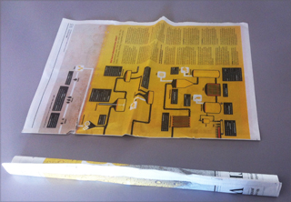

As already said before : the rhythmic  aspect of wrapping brings most of us into a meditative state and in that state we are able to project our intentions into the doll more easily, which of course we want to achieve for our Wishing Doll.

Often you have to purchase all kinds of stuff for your project, and that is keeping you from doing it. So it is stimulating to use everyday materials.
 For this doll you need a newspaper (tabloid), some leftover wool, adhesive tape and hobby glue, strong yarn to tie, and scissors.

 Roll up 2 double pages this way. Use adhesive tape to keep it in place.

 Then roll one double page this way.

 Fold the long one in a V-shape.
 Insert the short one into the V and tie them to form a body, or use tape.

The Wrapping can start now!
 Begin with the head and the hands, so that the "clothes" will be “over” the body parts.
 For children and less experienced hobbyists it is convenient to secure the woolen thread at its beginning with adhesive tape. It will not be visible, because you will be wrapping over it.
 When one colour is done, push the end of the yarn under the finished part with your scissors.
 The hands and feet are difficult to wrap. I used hobby glue before starting and used some more after finishing to keep it in place.

 For children it is easier to leave the face, hands and feet bare.
 These dolls are made of cardboard in stead of newsprint.

Draw, sew or paste the eyes, nose and mouth. Wrap yarn around 2 of 4 fingers for short or long hair and glue.

Make a nice resting place for your doll. Paint a shoebox f.i.
