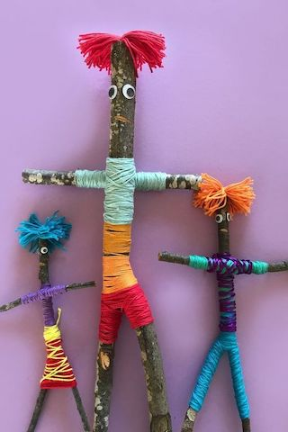

Gelukspoppen zijn er in allerlei soorten, voor allerlei groepen.

Om te beginnen zijn er Workshops Gelukspoppen voor KINDEREN.
 Te denken valt bijvoorbeeld aan een popje maken met natuurlijke materialen, die eerst buiten kunnen worden gezocht (groep 3, 4 en 5):

Of een wollen vriendje in een geheim doosje (groep 3, 4 en 5):

Of een wikkelpopje voor nog jongere kinderen:

Flessenpoppen zijn aan te passen aan  groepen van ALLERLEI LEEFTIJDEN:

 Leuk is, om een briefje in de fles te doen, voordat er verder wordt gewerkt. Zet erop, wat geluk voor jou betekent.

Een bijzonder soort gelukspop is de **Wenspop**. Dit is een pop waar we een speciale intentie in leggen.
 Poppen worden al eeuwenlang in veel culturen gebruikt voor genezing en verandering.
 Dat komt omdat een pop maken een krachtig medium is om met diepe delen van onszelf in contact te komen.
 Wenspoppen kunnen bijvoorbeeld Troostpoppen zijn. Er worden herinneringen in verwerkt: dat kunnen voorwerpen uit onze kindertijd zijn of dingen die ons aan een geliefd persoon doen denken.
 Wenspoppen kunnen Krachtpoppen zijn. We benadrukken in de pop een kant van onszelf, die we sterker willen maken.
 Wenspoppen kunnen natuurlijk ook gewoon Wenspoppen zijn. We stoppen er een briefje in, met een wens daarop geschreven. We kunnen ons concentreren op onze wens als we naar de pop kijken.

Deze Wenspop-workshops zijn met name geschikt voor teamuitjes, vriendinnenreunies e.d.

De wenspoppen kunnen diverse vormen hebben: de basis kan van takken gemaakt worden, er kan een simpel vierkant kussentje gebruikt worden of er kan een basispop (kussenpop) gebruikt worden.

(archief)
 Deze basispoppen zijn er in verschillende vormen en kleuren, met of zonder gezicht.
 Het zelf maken van borsten geeft de mogelijkheid om "bij het hart" een wens te verstoppen.
 De lengte van de basispop varieert tussen de 35 en 40 cm.

