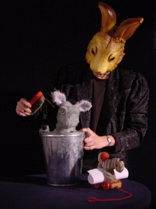
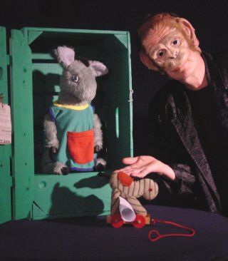

 Ontwerp affiche: Boris Reuderink

Deze voorstelling wordt niet meer gespeeld.

Inhoud: Ezeltje vindt zichzelf al heel groot en wil dus helemaal alleen naar het verjaarsfeest van zijn vriendje Varken. Maar dat valt toch niet mee!

Vrolijke vertelvoorstelling met poppen en maskers en veel verrassende effecten. De maskers worden erg voorzichtig geintroduceerd.
 De liedjes worden begeleid op trekharmonica en speeldoosje.

<iframe width="320" height="315" src="https://www.youtube.com/embed/czwT5IMOajA" frameborder="0" allowfullscreen></iframe>

